<div align="center">

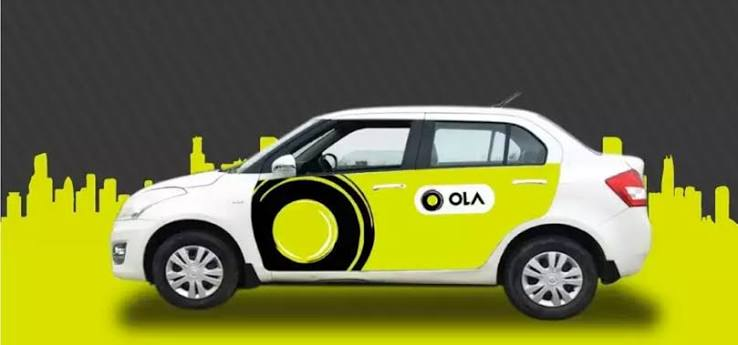

# 🚕 Ola Ride Insights

### Turning 103,024 ride bookings into an operations playbook
**SQL · Power BI · Python · Streamlit**

[](https://ola-ride-insights-jwjdraxa24hkybkfpudfkm.streamlit.app/)


**[👉 Open the live interactive dashboard](https://ola-ride-insights-jwjdraxa24hkybkfpudfkm.streamlit.app/)**

</div>

---

## 🎯 The Story in 30 Seconds

> Ola booked **₹56.5M** of rides in July 2024 but realised only **₹35.1M**. The **₹21.5M gap (38%)** comes from driver cancellations, unfulfilled requests and mid-ride failures, **not weak demand**. Demand is flat across every hour, weekday and vehicle type, so the growth lever is **supply reliability**.

| 103,024 | 62.1% | ₹35.08M | ₹21.45M | 63.7% | 91.6% |
|:---:|:---:|:---:|:---:|:---:|:---:|
| Bookings | Success rate | Realised revenue | Revenue not realised | Cancels driven by drivers | One-time customers |

---

## 📌 Business Problem

Ride-hailing platforms generate huge booking data but struggle to turn it into decisions on **driver allocation, pricing, customer experience and fraud**. This project builds an end-to-end analytics pipeline on Ola's July 2024 Bengaluru bookings to answer:

- How healthy is the business, and where does revenue leak?
- Why do rides fail, and who owns the fix?
- Which vehicle types, payment modes and customers drive value?
- Is service quality consistent?

## 🏗️ Architecture

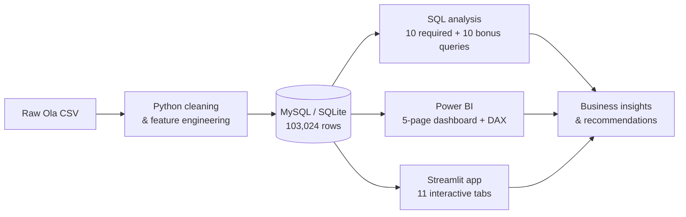

## 🔍 Key Insights

### 1. Demand is steady; the leak is structural
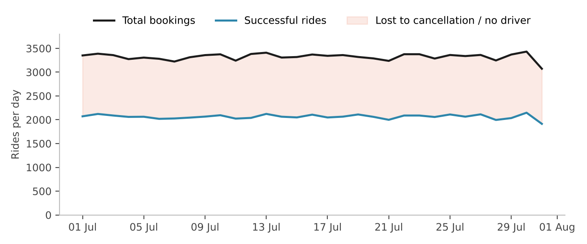

Bookings hold near **3,300/day** (range 3,072 to 3,432). Completed rides track bookings at a constant ~62%. Weekday vs weekend looks lopsided in raw counts (76,670 vs 26,354) only because July 2024 has 23 weekdays and 8 weekend days; per day they are near-identical (~3,333 vs ~3,294).

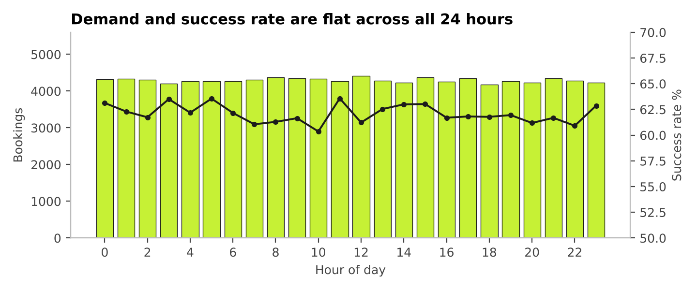

Success rate stays within **60.4–63.6% across all 24 hours**. No rush-hour fix is needed; consistency is.

### 2. Four in ten bookings fail
<table><tr>
<td>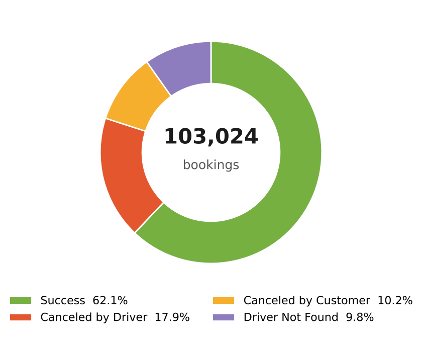</td>
<td>

| Outcome | Rides | Share |
|---|--:|--:|
| ✅ Success | 63,967 | 62.09% |
| 🚫 Cancelled by driver | 18,434 | 17.89% |
| 🙋 Cancelled by customer | 10,499 | 10.19% |
| 🔍 Driver not found | 10,124 | 9.83% |

</td></tr></table>

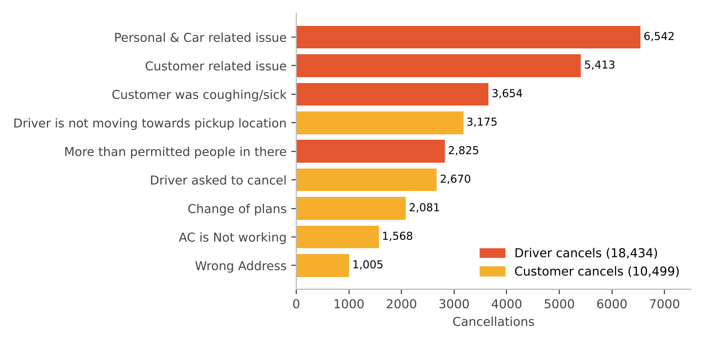

Drivers cause **63.7%** of cancellations. The top reason, *"Personal & Car related issue"* (6,542), is largely preventable with vehicle-health checks and better onboarding. Many customer cancels are also driver-caused: *"Driver is not moving towards pickup"* (3,175) and *"Driver asked to cancel"* (2,670).

> **Metric note:** the dashboard's 37.91% "Cancellation Rate" counts all unsuccessful outcomes including *Driver Not Found*. Strict cancellations are 28.08%.

### 3. Where the money goes
<table><tr>
<td>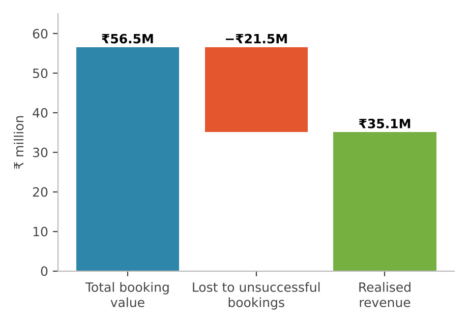</td>
<td>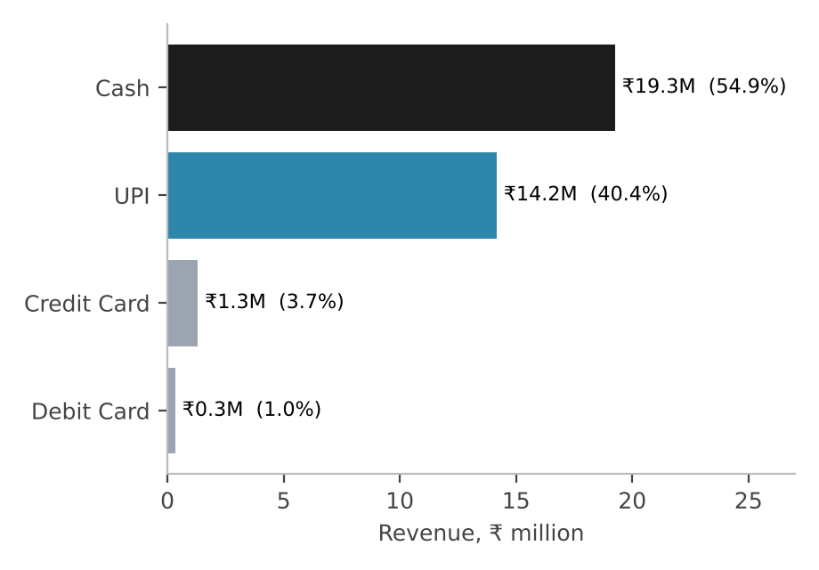</td>
</tr></table>

**Cash is 54.9%** of revenue, UPI 40.4%, cards under 5%. Fares are almost identical across payment methods (₹539–550), so payment mix is a behaviour lever, not a quality issue.

### 4. Auto is the pricing outlier
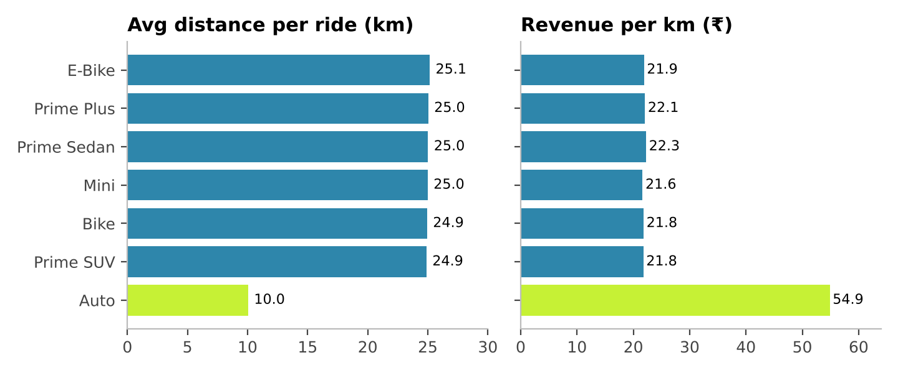

All 7 vehicle types get ~14.6K–14.9K bookings with 61.4–63.0% success. **Autos travel 10 km vs ~25 km** yet earn the same ~₹551 fare, so revenue per km is **₹54.9 vs ₹21.7–22.3 (2.5x)**. Across all rides, fare and distance are uncorrelated (r = 0.002), which warrants a pricing review.

### 5. Customers don't come back, and ratings are uniform
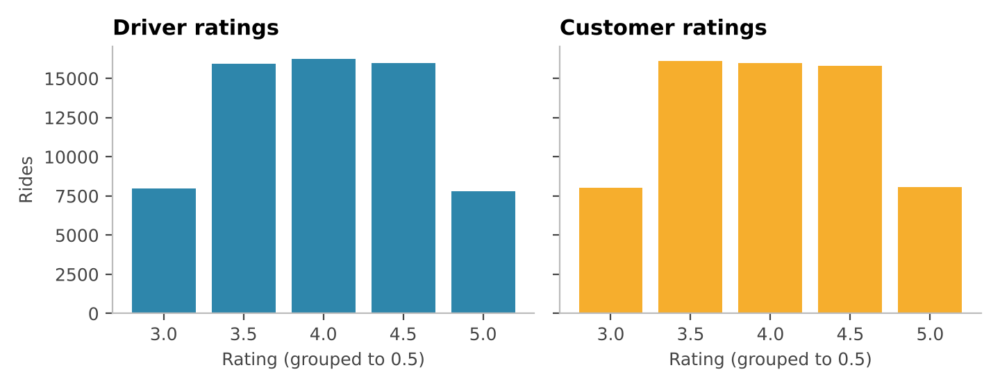

**91.6% of 94,544 customers rode only once.** Both rating sides average 4.00 and are uncorrelated (r ≈ 0), so ratings add little signal for ranking drivers; use cancellation and acceptance behaviour instead. **3,926 completed rides (6.1%)** ended incomplete: Customer Demand 41%, Vehicle Breakdown 41%, Other 19%.

## ✅ Recommendations

| Priority | Action | Evidence / sized impact |
|:--:|---|---|
| 1 | Driver cancellation scorecards, incentives and penalties | 18,434 driver cancels. Each +1 pt success rate ≈ 1,030 rides ≈ ₹0.57M/month* |
| 2 | Pre-trip vehicle-health checks | Top cancel reason: 6,542 rides |
| 3 | Review Auto pricing | Same fare, 60% shorter trips |
| 4 | UPI incentives + second-ride offer | 91.6% one-time riders; cash 54.9% |
| 5 | Investigate same pickup/drop bookings | 2,121 bookings flagged |

<sub>*Illustrative: 1 pt × 103,024 bookings × ₹548 average successful fare.</sub>

## 📊 Power BI Dashboard (5 pages)

Interactive slicers (date, vehicle, payment, pickup, status, day part), KPI cards and a custom Ola theme. DAX measures live in [`powerbi/02_dax_measures.dax`](powerbi/02_dax_measures.dax).

<details open>
<summary><b>1 · Overall Dashboard</b></summary>
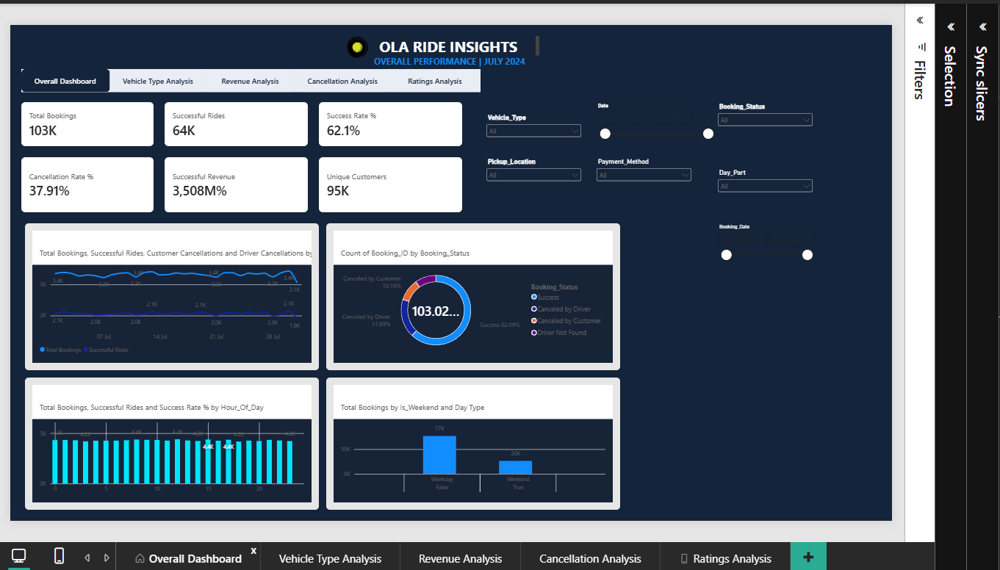
</details>

<details>
<summary><b>2 · Vehicle Type Analysis</b></summary>
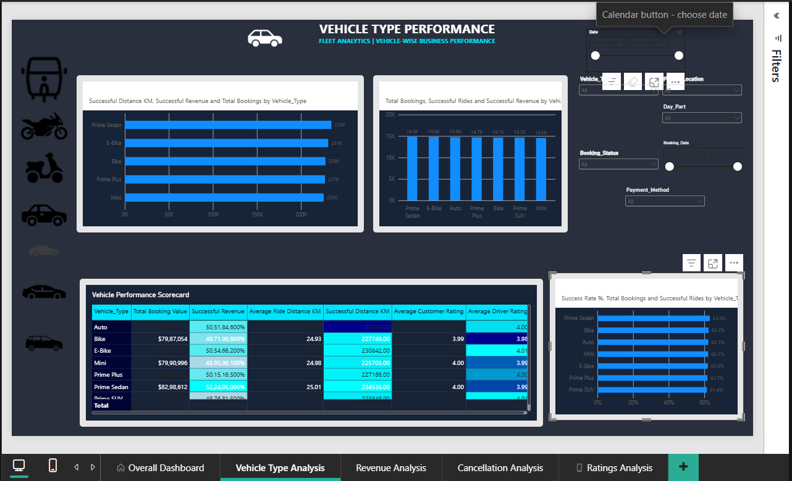
</details>

<details>
<summary><b>3 · Revenue & Customer Value</b></summary>
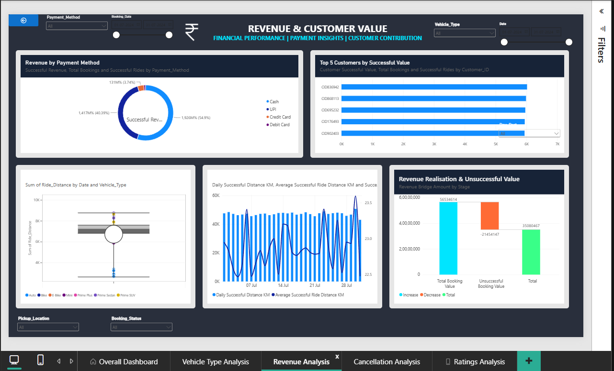
</details>

<details>
<summary><b>4 · Cancellation & Operations</b></summary>
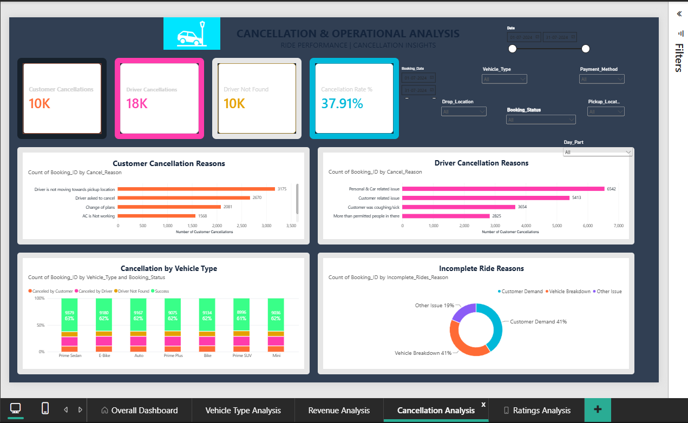
</details>

<details>
<summary><b>5 · Ratings Analysis</b></summary>
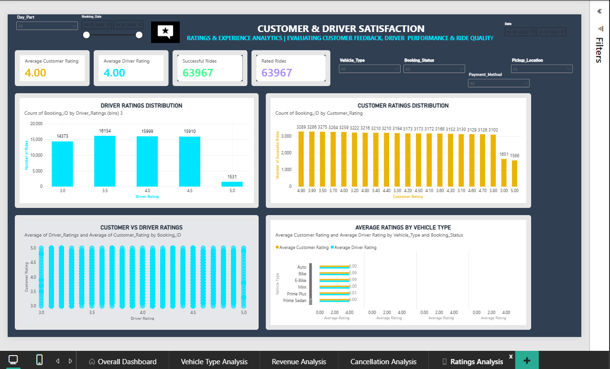
</details>

## 🌐 Streamlit App

**[Launch the app →](https://ola-ride-insights-jwjdraxa24hkybkfpudfkm.streamlit.app/)**

| Tab | What you can do |
|---|---|
| 📊 Overview · 🚗 Vehicle Types · 💰 Revenue · ❌ Cancellations · ⭐ Ratings | Plotly versions of the dashboard pages, driven by sidebar filters |
| 🚀 Advanced | Customer, route, demand-vs-supply, pricing and performance analysis, plus a predictive cancellation model |
| 🧪 SQL Playground | Run read-only SQL with validation, row limits, `EXPLAIN` and templates |
| 📑 SQL Analysis | Required Q1–Q10 and business analyses B1–B7 with charts and CSV download |
| 🔎 Booking Search | Look up bookings by ID, customer or route |
| 📈 Power BI · 💡 Insights | Embedded report and written findings |

## 🗄️ SQL Highlights

MySQL 8.0: staging table → typed table with `CHECK` constraints, six composite covering indexes, validation (V1–V3) and reconciliation (R1–R4) queries. Total successful booking value reconciles exactly to ₹35,080,467.

<details>
<summary><b>The 10 required questions and answers</b></summary>

| # | Question | Answer |
|:-:|---|---|
| 1 | All successful bookings | 63,967 rows |
| 2 | Avg distance per vehicle type | Auto 10.04 km; others 24.9–25.2 km |
| 3 | Cancelled by customers | 10,499 |
| 4 | Top 5 customers by rides | CID954071 (5), then four tied at 4 |
| 5 | Driver cancels: personal & car issue | 6,542 |
| 6 | Prime Sedan driver rating max / min | 5.0 / 3.0 |
| 7 | UPI rides | 25,881 |
| 8 | Avg customer rating per vehicle | 3.99–4.01 |
| 9 | Total booking value (successful) | ₹35,080,467 |
| 10 | Incomplete rides + reasons | 3,926 |

</details>

<details>
<summary><b>Sample query: vehicle scorecard (CTE + window function)</b></summary>

```sql
WITH v AS (
  SELECT Vehicle_Type, COUNT(*) AS bookings,
         SUM(Booking_Status = 'Success') AS successful,
         SUM(CASE WHEN Booking_Status = 'Success' THEN Booking_Value END) AS revenue
  FROM ola_rides GROUP BY Vehicle_Type)
SELECT Vehicle_Type, ROUND(100.0*successful/bookings,1) AS success_rate_pct,
       revenue, RANK() OVER (ORDER BY revenue DESC) AS revenue_rank
FROM v ORDER BY revenue_rank;
```
</details>

## 🧹 Data & Cleaning

- **103,024** bookings, 27 fields, 1–31 July 2024; `Booking_ID` unique.
- NULLs are structural (payment, ratings and turnaround exist only for completed rides); ratings are never treated as zero.
- Derived fields: `Hour`, `Day_Part`, `Is_Weekend`, `Cancel_By`, `Cancel_Reason`, `Is_Success`.
- Flags: 2,121 bookings share pickup and drop locations.

## 🛠️ Tech Stack

| Layer | Tools |
|---|---|
| Data prep & EDA | Python, Pandas, NumPy, Matplotlib, Seaborn, Jupyter |
| Database | MySQL 8.0, SQLite |
| BI | Power BI, DAX |
| App | Streamlit, Plotly, scikit-learn |
| Workflow | Git, GitHub |

## 📂 Repository Structure

```text
OLA-Ride-Insights/
├── app.py                      # Streamlit application
├── requirements.txt
├── data/ola_rides.db           # SQLite database used by the app
├── assets/                     # logo, dashboard screenshots, charts
├── notebooks/
│   ├── Ola_Ride_Insights.ipynb         # Python EDA
│   └── Ola_Ride_Insights_SQL.ipynb     # SQL analysis
├── sql/ola_ride_insights_mysql.sql
├── powerbi/
│   ├── OLA_RIDE_INSIGHTS.pbix
│   ├── 02_dax_measures.dax
│   └── 03_ola_theme.json
├── outputs/                    # ola_rides_clean.csv, summary CSVs
└── docs/Ola_Ride_Insights_Report.docx
```

## ▶️ Run Locally

```bash
git clone https://github.com/YOUR_GITHUB_USERNAME/OLA-Ride-Insights.git
cd OLA-Ride-Insights
python -m venv .venv && source .venv/bin/activate   # Windows: .venv\Scripts\activate
pip install -r requirements.txt
streamlit run app.py
```

## ⚠️ Limitations

- One month of data: no seasonality or year-on-year view.
- Success rate, ratings, distance and fares are unusually uniform, which suggests a synthetic or heavily sampled dataset. Validate on production data before acting.
- The brief's surge-pricing and fraud use cases can't be fully tested: there is no surge multiplier or driver ID.

## 🚀 Future Work

Demand forecasting · geospatial pickup/drop analysis · driver segmentation · predictive cancellation model in production · anomaly detection on fares and distances.

## 👨‍💻 Author

**P Suman Sangeet** · PGDM Big Data Analytics, Asia Pacific Institute of Management

Data Analytics · Business Intelligence · SQL · Python · Power BI

[GitHub](https://github.com/YOUR_GITHUB_USERNAME) · [LinkedIn](https://www.linkedin.com/in/YOUR_LINKEDIN)

---
<div align="center"><b>Turning data into insights. Turning insights into decisions.</b> ⭐ Star the repo if you found it useful.</div>
